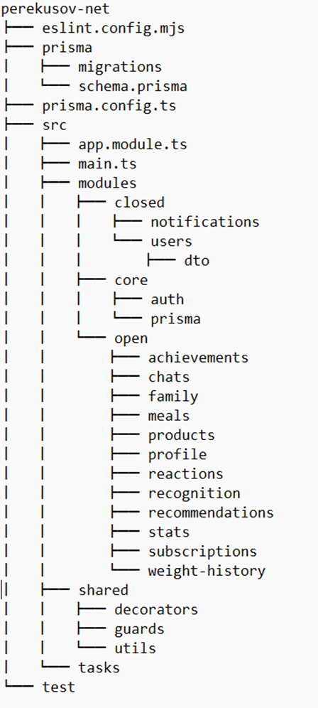

# Выпускная квалификационная работа "Разработка мобильного приложения для отслеживания рациона питания"
Государственный университет "Дубна". Образовательное направление: 09.03.04 Информатика и Вычислительная Техника (направленность (профиль) подготовкиЖ Технологии разработки программного обеспечения)

Автор: Барыкин Богдан Анатольевич, 4012

Руководитель: должность, Беднякова Татьяна Михайловна

# Краткое описание проекта
Данный проект представляет собой серверную часть мобильного приложения «Дневник питания»,
предназначенного для мониторинга рациона пользователя,
анализа пищевых привычек и формирования персонализированных рекомендаций.
  
Основная задача системы — помочь пользователю отслеживать своё питание,
фиксировать приёмы пищи, анализировать потребление калорий и макронутриентов,
а также выявлять возможные реакции организма на определённые продукты.
На основе собранных данных система способна формировать рекомендации с использованием технологий
искусственного интеллекта.

Ключевые особенности проекта  
-Модульная архитектура серверной части (на основе NestJS), обеспечивающ
ая масштабируемость и удобство сопровождения.  
-Полноценная система учёта приёмов пищи с детализацией состава (продукты, граммовка, время, фото).  
-Поддержка пользовательских продуктов и каталога.  
-Фиксация реакций организма на приёмы пищи и последующий анализ.  
-Система аналитики и статистики (калории, БЖУ, динамика веса).  
-Генерация персонализированных рекомендаций с использованием AI.  
-Поддержка семейных групп и взаимодействия между пользователями.  
-Встроенная система чатов и обмена сообщениями.  

# Технологический стек проекта

Языки: JavaScript, TypeScript и Prisma  
Фреймворки: NestJS, Node.js, Prisma, passport, openai  
Базы данных: PostgreSQL  
Инструменты: Git, Postman


# Структура репозитория




# Установка

1. Клонируйте репозиторий:
```bash
git clone https://vcs.uni-dubna.ru/BBA.22/perekusov-net.git
```


2. Установите зависимости (из корневой директории проекта):
```
    npm install
```

3. Найстройте переменные оокружения

```
DATABASE_URL=""
JWT_ACCESS_SECRET=""
JWT_REFRESH_SECRET=""
GOOGLE_CLIENT_ID=""
GEMINI_API_KEY=""

VISION_OPENROUTER_API_KEY=""
VISION_OPENROUTER_API_URL=""

RECOMMENDATION_OPENROUTER_API_KEY=""
RECOMMENDATION_OPENROUTER_API_URL=""
RECOMMENDATION_OPENROUTER_MODEL=""
```

4. Выполните миграции базы данных:
```
npx prisma migrate dev
```

5. Сгенерируйте Prisma Client:
```
npx prisma generate
```

6. Запустите сервер в режиме разработки:
```
npm run start:dev
```

Приложение будет доступно по адресу:
```
http://localhost:3000
```

  
Аппаратные требования:  
-Доступ к сети (для работы с внешними сервисами)  
 
Основное окружение  
-Node.js версии 24 и выше  
-npm (или yarn/pnpm)  
-Git (для клонирования репозитория)  
-База данных PostgreSQL версии 13 и выше
  
# Использование  
1. Откройте Postman  
2. Нажмите Import   
3. Выберите UniSpring Auth API Tests.postman_collection.json  
Всё — коллекция появится со всеми запросами, можно играться. Сначала надо зарегистрировать пользователя

# Лицензия, коммерческая тайна, права третьих лиц
MIT License

# Контакты
ФИО: Барыкин Богдан Анатольевич

Email: BOGDYA2004@gmail.com

Другие ссылки:
TG: @Bogdyan2

